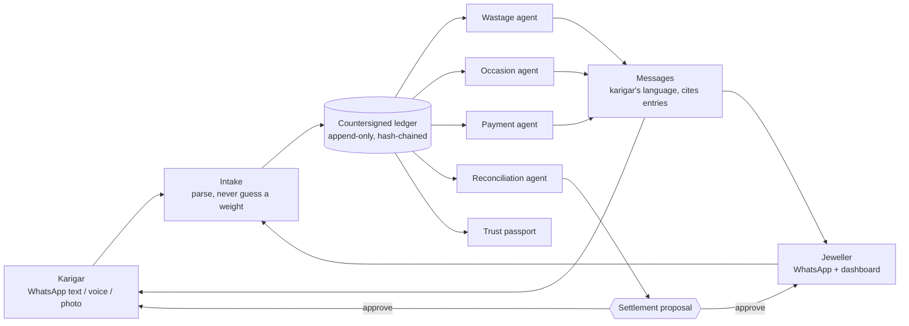

# Architecture

## One idea
A record both parties have signed cannot be argued about. Everything else in FineLedger exists to make
that record easy to create (WhatsApp), accurate (integer milligrams of fine gold) and useful (agents).

## Ledger
Every record is `{seq, rtype, data, ts, prev, hash}` where `hash = sha256(seq, rtype, data, ts, prev)`.
Changing any byte of any record breaks its hash; deleting or reordering a record breaks the `prev` link.
`Ledger.verify()` reports the first bad record.

| Record type | Purpose |
|-------------|---------|
| `party`, `order` | Registry: jeweller, karigar, refiner; an order links a jeweller, a karigar, a design, a due date and agreed labour |
| `entry` | A fact: `ISSUE`, `RETURN`, `SCRAP`, `RECOVERY`, `PAYMENT`, `DELAY_NOTE`, `REVERSAL` |
| `confirm`, `dispute` | A party signs an entry (HMAC over its hash) or contests it |
| `settlement`, `approve`, `reject` | A proposed settlement and each party's decision |
| `consent` | The karigar grants or withdraws passport sharing |

### Entry lifecycle
`pending` (one signature) -> `confirmed` (both) -> counts toward balances.
A dispute moves it to `disputed` until the disputing party re-confirms. Corrections are a new
`REVERSAL` entry that both confirm; history is never edited.

### Weights
Integer milligrams, `fine_mg = gross_mg * fineness / 1000` rounded half-to-even. No floating point
touches a weight. Inputs finer than 1 mg are rejected rather than rounded.

## Agents
Each agent is a deterministic, auditable function over the ledger. Contract: **observe, propose, explain,
cite the ledger entries used. Never decide, never settle.** The language model belongs at the edges
(understanding a voice note, phrasing a message), never in the arithmetic of who owes what.

| Agent | Observes | Produces |
|-------|----------|----------|
| Intake | A message | A structured entry, or a request to resend. Refuses to guess |
| Wastage | Closed orders per karigar and design | A suggested wastage with the evidence; flags outliers (robust z-score on median and MAD) |
| Occasion | Due date, issue date, past turnaround, current workload | Risk (green/amber/red), and reassignment options for a human to approve |
| Payment | Delivery date, labour, payments | Days waited, shown to both sides; a payer record for jewellers |
| Reconciliation | Confirmed entries; or two notebooks | A line-by-line diff; a settlement *proposal* that excludes anything unconfirmed |
| Trust passport | Closed orders | Components, not one opaque score; consent-gated export |

`agents/runner.py` is the loop: observe -> decide -> notify. It is stateless over a ledger snapshot, so a
scheduler can call it periodically and hand the messages to a WhatsApp gateway.

## Fairness, as enforced behaviour (each has a test)
- Gold still in the workshop is *not* a loss. Only closed orders can show a shortfall.
- Unconfirmed or disputed entries count for nobody; orders containing them are listed as blocked, not dropped.
- Lateness caused by the jeweller or customer is excluded from the passport when both confirmed the note.
- The jeweller has a payer record too, so late payment is as visible as late delivery.
- The karigar sees his entire account; a jeweller sees only the orders they share with him.
- The passport leaves the system only with the karigar's consent, which he can withdraw.

## Threat model (honest version)
- **Tamper-evident, not tamper-proof.** An operator who controls the whole file could rewrite *all* records
  and recompute every hash. Mitigation (roadmap): send each party a periodic chain digest over WhatsApp so
  either side can later prove what the chain looked like.
- **Signatures are HMACs in this prototype**, checked with a keyring. Production needs per-party keys held
  on the party's own device, bound to WhatsApp-verified identity and OTP.
- **Garbage in:** the ledger proves both parties agreed to a number, not that the number is true. The scale
  photo and OCR cross-check (`intake.scale_check`) reduce typos; a connected scale would reduce them further.
- **Privacy:** personal and financial data. Needs DPDP Act review, consent records (present) and retention rules (not yet).

## Scaling notes
The prototype keeps an in-memory index over a JSONL file. For production: Postgres with an insert-only
table (the same hash chain), and incremental statuses instead of rescanning.
